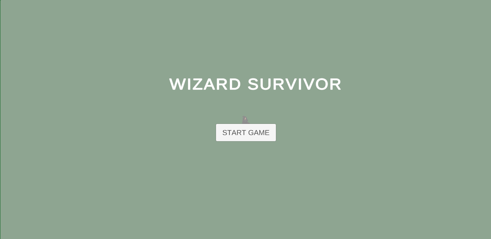
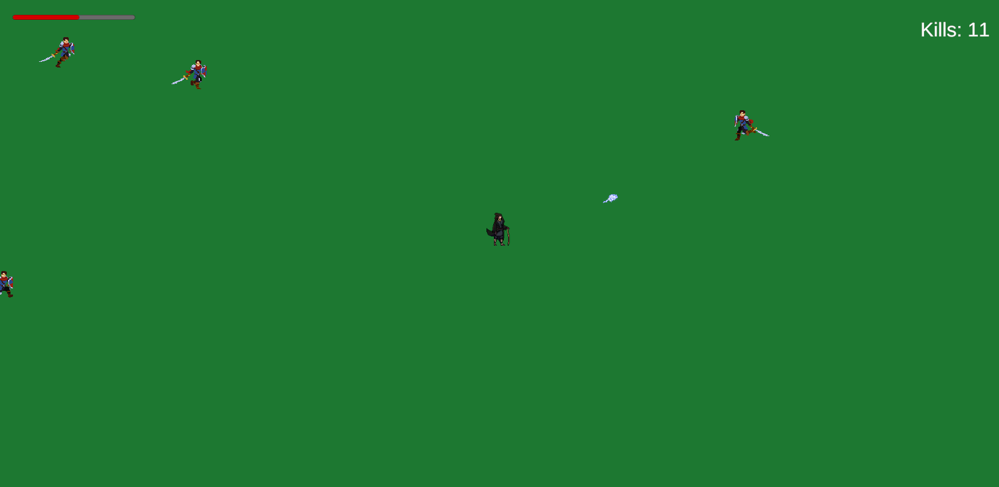
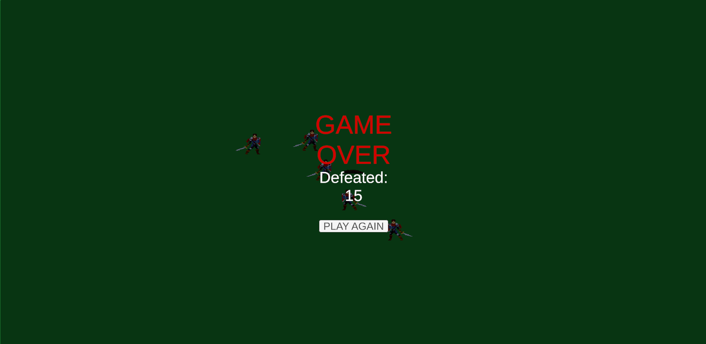

# Wizard Survivor (Unity)

A Vampire Survivors-style action roguelite made in Unity [βεπρ³�] and C#. You play as a
wizard surrounded by swordsmen, and you have to defeat as many as you can before they get you.

| Menu | Gameplay | Game over |
|---|---|---|
|  |  |  |

## Gameplay

- You control character with buttons WASD
- Enemies approach the wizard from all sides
- The wizard's magic bolts fire automatically to defeat them
- A health bar and a kill counter are always visible
- When health runs out, the game ends and shows how many enemies you defeated

## What I implemented

- Main menu, game over screen, and Play Again flow
- Player movement and health system with a health bar
- Enemy spawning and chasing AI
- Projectile attacks and enemy hit feedback
- Kill counter and final score

## How to run

1. Install Unity 6.3 via Unity Hub
2. Clone the repository and open the folder in Unity Hub
3. Open the main scene in `Assets/Scenes/` and press Play

## Tech

Unity, C#